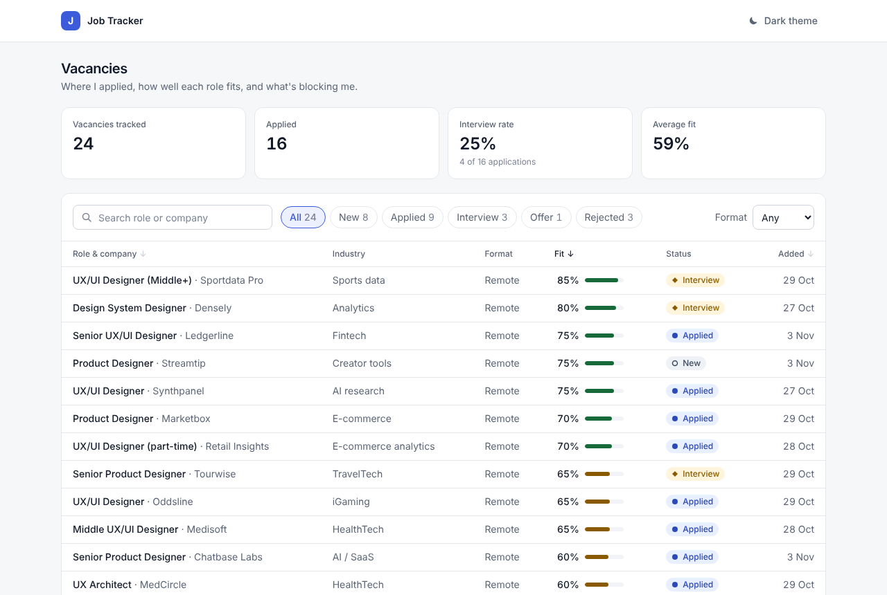
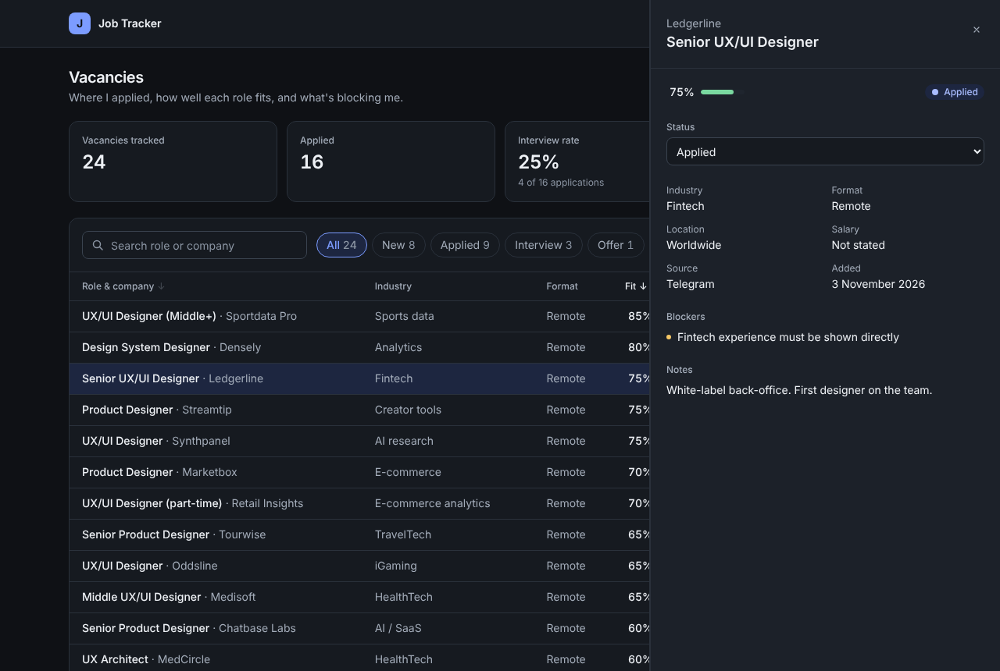
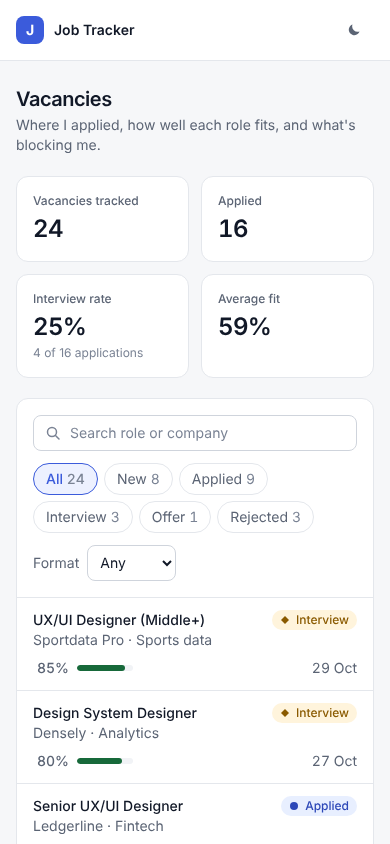
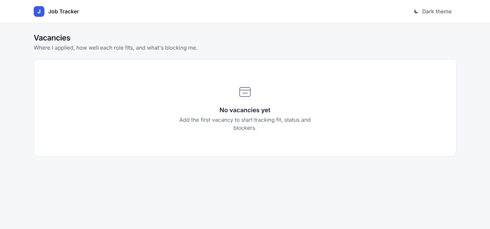
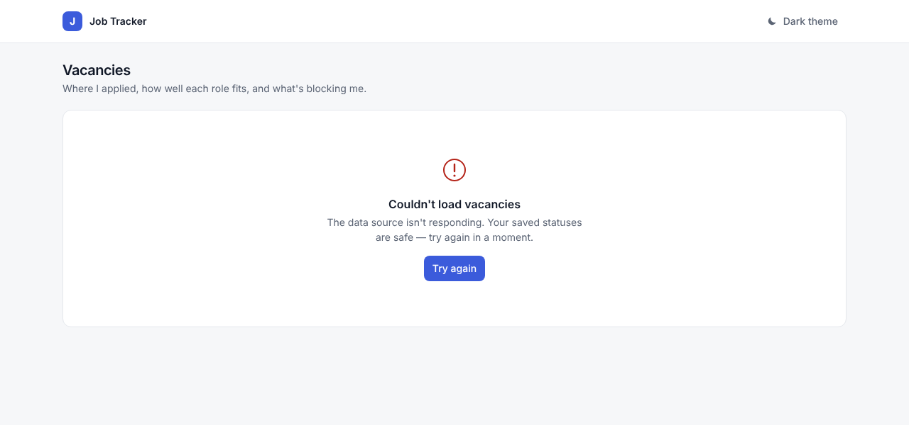

# Job Tracker

A small dashboard for tracking job applications: fit score, status and blockers for each vacancy.
Designed in Figma and built in code with AI coding tools by [Ekaterina Romanova](https://designer-ekaterina-rn.super.site/), product designer.

**Live demo:** _add your Vercel link here_




## Why this project

I design data-dense B2B interfaces — CRMs, dashboards, admin panels. This project shows how I take that work past Figma: a design system in tokens, a reusable component set and every interface state, shipped as a working product.

## What's inside

- **Design tokens for two equal themes.** All colors, radii and density live in `src/styles/tokens.css` as semantic variables (`--surface`, `--text-muted`, `--status-offer-fg`). Light and dark use the same names, so components never know which theme is on. In dark mode, shadows are replaced with borders.
- **Dense, scannable table.** 40px rows, tabular numbers, sortable columns with `aria-sort`, sticky header, long values truncated.
- **Side panel instead of a modal.** Details open next to the table, so the list stays in view. Closes with Esc; focus moves into the panel.
- **Every state designed.** Loading skeleton, empty list, no results after filtering (with "Clear filters"), and an error with retry. Preview them with `?state=empty` and `?state=error`.
- **Accessibility.** Status is shown with an icon and a label, never color alone. Visible keyboard focus, labelled controls, reduced-motion support.
- **Responsive.** Below 768px the table becomes a list: secondary columns move under the title instead of scrolling sideways.
- **Persistence.** Status changes and theme are saved in `localStorage`.

| Mobile | Empty state | Error state |
| --- | --- | --- |
|  |  |  |

## How I work with AI agents

Most of the code here was written by Claude Code from my specs; I designed it, set the rules and reviewed every change.
The agent works inside guardrails I wrote for it:

- [`CLAUDE.md`](CLAUDE.md) — design-system rules the agent follows on every task: tokens only, all states, accessibility, copy, workflow.
- [`.claude/skills/new-component`](.claude/skills/new-component/SKILL.md) — a repeatable procedure for building components.
- [`docs/specs/add-vacancy.md`](docs/specs/add-vacancy.md) — an example spec for the next feature: states, edge cases, error copy, acceptance criteria.
- [`docs/ai-workflow.md`](docs/ai-workflow.md) — the full loop, how I review agent output and where AI tends to make things up.

## Stack

React 19 · TypeScript · Vite · Tailwind CSS v4

## Run locally

```bash
npm install
npm run dev      # http://localhost:5173
npm run build    # production build in dist/
```

## Project structure

```
src/
  styles/tokens.css   design tokens (both themes)
  index.css           tokens → Tailwind utilities
  components/         Button, StatusBadge, FitScore, FilterBar, JobsTable, JobSidebar, StatCards, States
  hooks/              useJobs (data + states), useTheme
  data/jobs.ts        demo data (fictional companies)
```

## Roadmap

- [ ] Add / edit vacancy form with validation
- [ ] Import vacancies from a CSV
- [ ] Notes timeline per vacancy
- [ ] Virtualized table for thousands of rows
